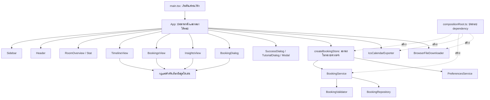
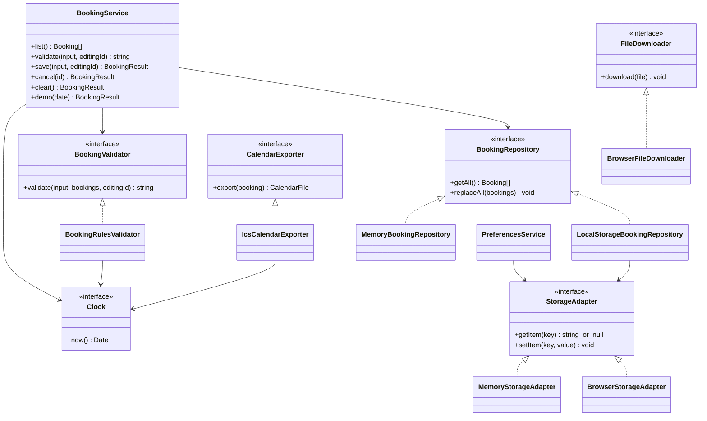
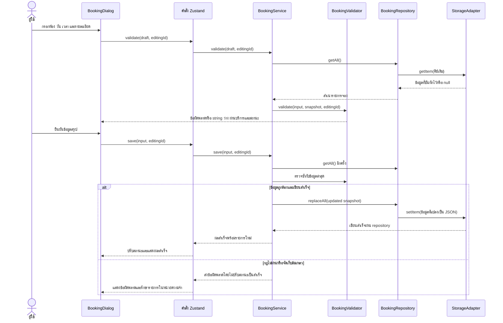

# สถาปัตยกรรมและการประยุกต์ใช้ SOLID ในระบบจองห้องประชุม KMITL

## เทคโนโลยีและความสอดคล้องกับเกณฑ์ประเมิน

โครงงานใช้ **React 18 และ TypeScript** ร่วมกับ Vite, Zustand, React Router, Tailwind CSS v4, Motion และ Radix Dialog ยังคงเป็นเว็บแอปในเบราว์เซอร์ ไม่ได้ย้ายไปใช้ Python

SOLID เป็นหลักการออกแบบเชิงวัตถุที่ไม่จำกัดภาษา ระบบนี้ใช้ interface, class, module และ constructor dependency injection ของ TypeScript เพื่อแสดงหลักการเดียวกัน หน้าจอใช้ function components ตามแนวทาง React ส่วนบริการและตัวเชื่อมต่อใช้คลาสเมื่อช่วยให้หน้าที่กับสัญญาการทำงานชัดเจน

**ไม่ได้อ้างว่าใช้ Python หรือผ่าน PEP 8** เพราะ PEP 8 เป็นแนวทางเฉพาะ Python โค้ดนี้ใช้ PascalCase สำหรับ component/class/interface, camelCase สำหรับฟังก์ชันและตัวแปร เปิด `strict: true` แยกโมดูล และจัดรูปแบบด้วย Prettier การตั้งชื่อสอดคล้องกับธรรมเนียมที่พบร่วมกับ ESLint แต่ยังไม่ได้ติดตั้ง ESLint การเทียบหลักการไม่ใช่การยกเว้นเงื่อนไขภาษา ต้องให้อาจารย์ยอมรับก่อน

| แนวคิด Python ในเกณฑ์       | สิ่งที่ใช้ใน TypeScript/React                                                                            |
| --------------------------- | -------------------------------------------------------------------------------------------------------- |
| โมดูลและแพ็กเกจ             | ES modules และโฟลเดอร์ `domain/`, `services/`, `repositories/`, `components/`                            |
| คลาสและข้อมูลประจำวัตถุ     | คลาส TypeScript รับ dependency ผ่าน constructor และใช้ `private readonly`                                |
| คลาสฐานนามธรรมหรือ protocol | structural interfaces เช่น `BookingRepository`, `BookingValidator`, `StorageAdapter`, `CalendarExporter` |
| การระบุชนิดข้อมูล           | interface, union, function type และโหมด strict                                                           |
| การสืบทอดและการใช้แทนกัน    | ตรวจสัญญาพฤติกรรมร่วมกัน และเลือกการประกอบวัตถุแทนการสืบทอดเมื่อเหมาะสม                                  |
| การทดสอบด้วย pytest         | Vitest สำหรับหน่วยและการทำงานร่วมกันของบริการ/repository                                                 |
| การตั้งชื่อและรูปแบบ PEP 8  | ธรรมเนียม TypeScript และ Prettier ซึ่ง **ไม่ใช่การผ่าน PEP 8**                                           |
| การส่ง dependency จากภายนอก | ประกอบ constructor arguments ใน `compositionRoot.ts`                                                     |
| คลาสหน้าจอ                  | function component ที่มี typed props และสถานะปฏิสัมพันธ์เฉพาะส่วน                                        |

## ภาพรวมสถาปัตยกรรม

ใช้สถาปัตยกรรมแบ่งชั้นขนาดเล็ก และมีจุดประกอบ dependency สำหรับการใช้งานจริง เริ่มต้นด้วยรายการจองว่าง อ่านข้อมูลเดิมถ้ามี และโหลดข้อมูลตัวอย่างเมื่อผู้ใช้สั่งเท่านั้น

```text
src/
  main.tsx              เริ่มต้น React และตัวครอบเฟรมเวิร์ก
  App.tsx               ประกอบหน้าและประสานสถานะหน้าจอ
  compositionRoot.ts    ประกอบ dependency ที่ใช้งานจริง
  components/           ส่วนประกอบหน้าจอที่แยกหน้าที่
  types/                แบบจำลองและสัญญาการทำงาน
  domain/               กฎจอง ข้อมูลห้อง ตัวคัดเลือก และตัวสร้างข้อมูล
  services/             กรณีใช้งาน ปฏิทิน การดาวน์โหลด และค่ากำหนด
  security/             ตรวจขอบเขตข้อมูลจริงขณะทำงาน
  repositories/         การอ่านเขียนรายการจองและตัวเชื่อมต่อพื้นที่จัดเก็บ
  state/                ตัวปรับผลบริการเป็นสถานะ Zustand ในหน่วยความจำ
  utils/                ฟังก์ชันช่วยด้านวันเวลาและชื่อคลาส
  domain.ts             ทางเข้าที่คงความเข้ากันได้กับโค้ดเดิม
  store.ts              ทางเข้าสถานะที่คงความเข้ากันได้กับโค้ดเดิม
```

### ชั้นการทำงานและทิศทาง dependency

1. **ชั้นนำเสนอ:** `App` ประกอบหน้าจอ แต่ละ component ดูแลสถานะปฏิสัมพันธ์ เช่น ข้อมูลร่าง การลาก ตัวกรอง และการเปิดกล่องโต้ตอบ ไม่เขียนรายการจองลง localStorage เอง
2. **ชั้นกรณีใช้งาน:** `BookingService` ประสานการบันทึก แก้ไข ยกเลิก สร้างตัวอย่าง และล้างข้อมูล อ่านข้อมูลล่าสุด ตรวจนโยบาย แล้วจัดเก็บก่อนส่งผลสำเร็จให้สถานะ
3. **ชั้นโดเมน:** `bookingRules.ts` ตรวจข้อมูล เวลาทับซ้อน และเงื่อนไขยกเลิก ส่วน `selectors.ts` คัดกรองความว่าง จัดกลุ่ม และคำนวณสถิติ ไม่มี dependency ต่อ React, Zustand, DOM หรือ localStorage
4. **ชั้นโครงสร้างพื้นฐาน:** repository อ่านเขียนผ่าน `StorageAdapter`; `BrowserStorageAdapter` เข้าถึงพื้นที่จัดเก็บ; `BrowserFileDownloader` ดูแล DOM/Blob/object URL; `IcsCalendarExporter` สร้างเฉพาะข้อมูลไฟล์
5. **จุดประกอบ:** `compositionRoot.ts` สร้าง dependency แบบใช้งานจริง ส่วน `createBookingStore` ปรับผลบริการให้หน้าจอโดยไม่ใช้ middleware จัดเก็บถาวรของ Zustand

บริการขึ้นกับสัญญาใน `types/contracts.ts` ตัวเชื่อมต่อแบบใช้งานจริงขึ้นกับสัญญาเดียวกัน จุดประกอบสามารถนำเข้าคลาสจริงได้โดยตั้งใจ แต่บริการธุรกิจไม่จำเป็นต้องรู้ว่าถูกสร้างจากที่ใด

## หน้าที่ของส่วนประกอบหน้าจอ

| ส่วนประกอบ/โมดูล                  | หน้าที่                                                                       |
| --------------------------------- | ----------------------------------------------------------------------------- |
| `main.tsx`                        | เริ่ม React, error boundary, router และการเคารพการตั้งค่าลดภาพเคลื่อนไหว      |
| `App`                             | ประกอบหน้าปัจจุบัน เชื่อมคำสั่ง ประสานกล่องโต้ตอบ ค่ากำหนด และการแจ้งเตือน    |
| `Sidebar`, `Header`               | เมนูพื้นที่ทำงาน บทบาทจำลอง การเปลี่ยนธีม และคู่มือ                           |
| `RoomOverview`, `Stat`            | ภาพรวมพื้นที่ประชุมและตัวชี้วัดที่ใช้ซ้ำได้                                   |
| `TimelineView`                    | ค้นหา/กรอง ตารางครึ่งชั่วโมง การลากและคีย์บอร์ด โดยเรียกกฎโดเมนสำหรับความว่าง |
| `BookingsView`                    | กลุ่มและการ์ดการจอง พร้อมคำสั่งแก้ไข ทำสำเนา ยกเลิก แชร์ และส่งออก            |
| `InsightsView`                    | แสดงสถิติและกราฟจากค่าที่โดเมนคำนวณ                                           |
| `BookingDialog`                   | แบบฟอร์มร่าง สรุป และข้อผิดพลาด โดยเรียก validation/save callbacks ที่รับมา   |
| `Modal`                           | การเข้าถึง โฟกัส และการเปลี่ยนผ่านด้วย Radix/Motion                           |
| `SuccessDialog`, `TutorialDialog` | ยืนยันผลสำเร็จและแนะนำการใช้งานครั้งแรก                                       |
| `ErrorBoundary`                   | แสดงหน้าสำรองเมื่อแสดงผลล้มเหลวและให้โหลดใหม่                                 |
| `createBookingStore`              | ปรับผลสำเร็จเป็นสถานะในหน่วยความจำและส่งข้อผิดพลาดให้หน้าจอ                   |

การเปลี่ยนตัวกรองหรือเปิดกล่องโต้ตอบคงอยู่ใน component ที่เกี่ยวข้อง ส่วนโครงหน้าหลักกับกล่องยืนยันทั่วไปอยู่ใน `App` ไม่แยกทุกองค์ประกอบย่อยเป็นคลาส เพราะจะเพิ่มความซับซ้อนโดยไม่ช่วยหน้าที่ให้ชัดขึ้น

## หน้าที่ของคลาสและ interface

| สัญญา/คลาส                                | หน้าที่และเงื่อนไข                                                                 |
| ----------------------------------------- | ---------------------------------------------------------------------------------- |
| `BookingRepository`                       | อ่านสำเนารายการและแทนที่ข้อมูลแบบ synchronous; เมื่อจัดเก็บล้มเหลวให้โยนข้อผิดพลาด |
| `LocalStorageBookingRepository`           | อ่าน ตรวจรูปแบบข้อมูลเดิม และบันทึกผ่านสัญญาพื้นที่จัดเก็บ                         |
| `MemoryBookingRepository`                 | ให้พฤติกรรมเดียวกันด้วยสำเนาข้อมูลในหน่วยความจำสำหรับทดสอบ                         |
| `StorageAdapter`                          | อ่าน string หรือ null และเขียน string โดยส่งต่อข้อผิดพลาด                          |
| `BrowserStorageAdapter`                   | เรียกพื้นที่จัดเก็บของเบราว์เซอร์ผ่านผู้จัดหาที่รับมา                              |
| `MemoryStorageAdapter`                    | เก็บ string ใน Map สำหรับทดสอบ repository                                          |
| `BookingValidator`                        | คืนข้อผิดพลาดแรก หรือ string ว่างเมื่อผ่าน                                         |
| `BookingRulesValidator`                   | ประเมิน `BookingRule` ตามลำดับด้วย clock ที่รับมา                                  |
| `BookingService`                          | ประสานสำเนาข้อมูล กฎ ตัวสร้าง ID และคำสั่งจอง                                      |
| `Clock`                                   | จัดหาวันเวลาปัจจุบันเพื่อให้ทดสอบเงื่อนไขเวลาได้แน่นอน                             |
| `CalendarExporter`                        | แปลงการจองเป็นเนื้อหาและข้อมูลกำกับไฟล์                                            |
| `IcsCalendarExporter`                     | เข้ารหัสข้อความ แปลงเวลาไทยเป็น UTC และตัดบรรทัด UTF-8                             |
| `FileDownloader`, `BrowserFileDownloader` | ส่งข้อมูลไฟล์ออกผ่าน API ของเบราว์เซอร์                                            |
| `PreferencesService`                      | แยกค่ากำหนดธีม คู่มือ และบทบาทออกจากรายการจอง และทนต่อพื้นที่จัดเก็บที่ถูกปิด      |

## ความเป็นเอกภาพของหน้าที่ (High Cohesion)

แต่ละโมดูลรวมพฤติกรรมที่เปลี่ยนด้วยเหตุผลเดียวกัน กฎการจองอยู่ใน `bookingRules.ts` จึงแก้เงื่อนไขยกเลิกได้โดยไม่แก้การ์ดหน้าจอ การจัดรูปแบบข้อมูลจัดเก็บอยู่ใน repository แบบฟอร์มอยู่ใน `BookingDialog` ส่วนการเข้ารหัสปฏิทินกับการดาวน์โหลดอยู่คนละโมดูล สถานะการลากเป็นของตารางเวลาแทนที่จะอยู่ในจุดเริ่มโปรแกรม

## การพึ่งพากันต่ำ (Low Coupling)

`BookingService` รับ interface แทนการสร้างพื้นที่จัดเก็บเอง สถานะรับบริการกับค่ากำหนดจากภายนอก หน้าจอรับข้อมูลและ callbacks ที่ระบุชนิด ชุดทดสอบ repository กฎ และปฏิทินจึงทำงานโดยไม่ต้องเปิดเบราว์เซอร์ การเปลี่ยน repository ที่รักษาสัญญา synchronous เดิมไม่ต้องเปลี่ยนอัลกอริทึมของบริการ

บาง dependency จำเป็น เช่น กฎความจุอิงรายการห้องจริง หน้าจอกับ routing ยังคงเป็น React และรูปแบบจัดเก็บต้องรักษาข้อมูลเดิม หากเพิ่ม API แบบ asynchronous ต้องเปลี่ยนสัญญาอย่างชัดเจน ไม่ถือว่าใช้แทน synchronous repository ได้ทันที

## การประยุกต์ใช้ SOLID

### หลักความรับผิดชอบเดียว — Single Responsibility Principle (SRP)

เดิมจุดเริ่มโปรแกรมรวมหน้าจอ แบบฟอร์ม ตัวกรอง การประสานจัดเก็บ การตรวจสอบ และการส่งออก ปัจจุบัน `main.tsx` เริ่มต้นแอปเท่านั้น ส่วน component แสดงผล กฎตรวจข้อมูล repository จัดเก็บ และ exporter สร้างข้อมูลไฟล์ แบ่งตามเหตุผลที่ทำให้เปลี่ยน ไม่ใช่บังคับหนึ่งคลาสต่อหนึ่งฟังก์ชัน

### หลักเปิดรับการขยายและปิดการแก้แกนเดิม — Open/Closed Principle (OCP)

validator รับรายการ `BookingRule` ตามลำดับ เพิ่มนโยบายผ่านกฎที่ส่งตอนสร้างวัตถุได้โดยไม่แก้ลูปหรือ `BookingService` ลำดับกำหนดข้อผิดพลาดแรกที่ผู้ใช้เห็น มีชุดทดสอบเพิ่มกฎแยกใน `domain/bookingRules.test.ts`

### หลักการใช้แทนกันได้ — Liskov Substitution Principle (LSP)

`MemoryBookingRepository` และ `LocalStorageBookingRepository` รักษาสัญญาเดียวกัน ได้แก่ เริ่มว่าง อ่านสำเนาที่แยกจากข้อมูลต้นฉบับ แทนที่ข้อมูล และส่งข้อผิดพลาดตามเงื่อนไข ใช้ **ชุดทดสอบสัญญาและกรณีใช้งานชุดเดียวกันกับทั้งสองแบบ** ใน `repositories/bookingRepository.test.ts` ตัวเชื่อมต่อพื้นที่จัดเก็บก็ทดสอบการอ่านคีย์ที่ไม่มีและเขียนทับค่าเดียวกัน

`implements` ตรวจรูปแบบในช่วง compile เท่านั้น ไม่พิสูจน์พฤติกรรมทั้งหมด จึงต้องมีการทดสอบเพิ่ม สภาพพร้อมใช้งานของพื้นที่จัดเก็บต่างกันได้ เพราะสัญญาอนุญาตให้โยนข้อผิดพลาดและให้บริการ/สถานะจัดการต่อ

### หลักแยกสัญญาตามหน้าที่ — Interface Segregation Principle (ISP)

ไม่มี interface เดียวรวมการเก็บข้อมูล คำสั่งจอง การตรวจสอบ ปฏิทิน การดาวน์โหลด และค่ากำหนด `BookingRepository` ดูแลสำเนารายการ `StorageAdapter` ดูแล string และ `CalendarExporter` สร้างข้อมูลไฟล์ บริการไม่ต้องพึ่งคำสั่งส่งออก และ exporter ไม่ต้องพึ่ง repository

### หลักกลับทิศการพึ่งพา — Dependency Inversion Principle (DIP)

`BookingService` ขึ้นกับ `BookingRepository`, `BookingValidator`, `Clock` และฟังก์ชันสร้าง ID ไม่เรียก `localStorage`, `window`, `document` หรือ Zustand ส่วน repository ขึ้นกับ `StorageAdapter` จุดประกอบส่งคลาสจริง และชุดทดสอบส่งตัวเชื่อมต่อหน่วยความจำกับ clock ที่ควบคุมได้

## ตัวอย่างโค้ดสำคัญ

### 1. กฎตรวจสอบที่ขยายได้

โค้ดจาก `src/domain/bookingRules.ts`:

```typescript
export class BookingRulesValidator implements BookingValidator {
  constructor(
    private readonly rules: readonly BookingRule[] = defaultBookingRules,
    private readonly clock: Clock = systemClock,
  ) {}

  validate(input: BookingInput, bookings: readonly Booking[], editingId?: string): string {
    const context: ValidationContext = { bookings, editingId, now: this.clock.now() };
    for (const rule of this.rules) {
      const error = rule(input, context);
      if (error) return error;
    }
    return '';
  }
}
```

แสดง SRP ในการประเมินกฎ OCP ในการรับกฎเพิ่ม และ DIP ในการรับเวลา กฎตรวจชนิดข้อมูล วันที่จริง เวลาอนาคต ช่วงครึ่งชั่วโมง ข้อมูลจำเป็น อีเมล โทรศัพท์ ความจุ และเวลาทับซ้อน รายการยกเลิกไม่กีดกันเวลา ส่วนการแก้ไขไม่นับ ID ของตัวเองแต่ยังตรวจรายการอื่น

### 2. การส่ง dependency จากจุดประกอบ

โค้ดจาก `src/compositionRoot.ts`:

```typescript
const storage = new BrowserStorageAdapter();
const repository = new LocalStorageBookingRepository(storage);
const validator = new BookingRulesValidator();
export const preferences = new PreferencesService(storage);
const service = new BookingService(repository, validator, systemClock, () => crypto.randomUUID());
export const useStore = createBookingStore(service, preferences);
```

constructor ใน `src/services/bookingService.ts` รับสัญญา:

```typescript
constructor(
  private readonly repository: BookingRepository,
  private readonly validator: BookingValidator,
  private readonly clock: Clock,
  private readonly nextId: () => string,
) {}
```

บริการไม่สร้าง repository เอง การยกเลิกตรวจ `canCancel` ก่อนเขียน จึงไม่ได้พึ่งปุ่ม disabled เป็นจุดตรวจเพียงจุดเดียว

## แผนภาพส่วนประกอบ



## แผนภาพคลาสและ interface

ชื่อคลาส เมธอด ชนิดข้อมูล และเครื่องหมาย `interface` คงตรงกับโค้ดเพื่อให้ตรวจสอบได้



`CalendarFile` คือสัญญาข้อมูลชื่อไฟล์ เนื้อหา และ MIME ที่ exporter คืนมา ตัวสร้าง ID เป็นฟังก์ชัน และ `BookingRule` เป็นชนิดฟังก์ชัน ไม่ได้สร้างลำดับสืบทอดคลาสที่ไม่จำเป็น

## แผนภาพการไหลของข้อมูลการจอง



การตรวจซ้ำตอนบันทึกจำเป็น เพราะการแสดงสรุปไม่ได้อนุญาตให้ข้ามนโยบาย การยกเลิกใช้ขอบเขตบริการ/repository เดียวกันและต้องเหลือเวลามากกว่า 24 ชั่วโมง ข้อมูลตัวอย่างเป็นคำสั่งแยกที่ตั้งใจอนุญาตให้สาธิตวันที่ในอดีต

## ความเข้ากันได้ของข้อมูลเดิมและการจัดการข้อผิดพลาด

- ใช้คีย์ `kmitl-booking-v1` และโครง `{ state: { bookings, ... }, version: 0 }` เดิม รักษารายการและ field เดิมใน `state`
- repository รักษา `state.role` เก่าไว้ให้ `PreferencesService` อ่านสำรอง การเลือกบทบาทใหม่ใช้ `kmitl-role`
- ธีมกับคู่มือยังใช้ `kmitl-dark` และ `kmitl-tour` ผ่านบริการค่ากำหนด
- JSON ผิด รูปแบบรายการผิด เวอร์ชันไม่รองรับ หรือข้อมูลเกินขอบเขตจะแจ้งข้อผิดพลาดและไม่ถูกเขียนทับ ต้องสำรองแล้วซ่อมหรือลบคีย์ด้วยตนเองหากข้อมูลเสีย
- การเขียนล้มเหลวไม่ทำให้หน้าจอแสดงว่าจองสำเร็จ ข้อผิดพลาดส่งผ่านบริการและสถานะ ส่วนค่ากำหนดหน้าจอยอมให้ใช้ต่อในรอบนั้นได้
- error boundary ดูแลการแสดงผลล้มเหลว การดาวน์โหลดหรือ clipboard ล้มเหลวจะแจ้งเตือน

## การตรวจสอบและการป้องกันข้อผิดพลาดเดิมกลับมา

```sh
npm run build
npm test
npm run test:e2e
npm run test:deployment
npm run format:check
```

ทดสอบการจองถูกต้อง ขอบเขตความจุ วันที่/อีเมล/โทรศัพท์/เวลาไม่ถูกต้อง เวลาทับซ้อนและต่อกัน รายการยกเลิก การแก้รายการตัวเองและชนรายการอื่น จุดตัดยกเลิก ID ที่ไม่มี ข้อมูลตัวอย่าง/ล้างข้อมูล สัญญา repository/พื้นที่จัดเก็บ การโหลดข้อมูลเดิม ข้อมูลเสีย การเขียนล้มเหลว และปฏิทินตามเขตเวลา

การทดสอบเบราว์เซอร์ครอบคลุมค้นหา สร้าง/แก้ไข/ยกเลิก บันทึกข้ามการโหลดหน้า ดาวน์โหลด ICS คีย์บอร์ด ลาก ตัวกรอง โหมดมืด ข้อความ XSS และหน้าจอคอมพิวเตอร์/มือถือ ไม่ใช่การรับรองการเข้าถึงทั้งหมดหรือทุกอุปกรณ์

## เหตุผลการออกแบบและข้อแลกเปลี่ยน

- เลือกการประกอบวัตถุแทนการสืบทอดเมื่อเหมาะสม ใช้คลาสกับบริการ/ตัวเชื่อมต่อ และคง function components สำหรับ React
- สัญญา synchronous ขนาดเล็กเหมาะกับต้นแบบเบราว์เซอร์เดียว การเพิ่มบริการระยะไกลต้องมี async use cases สถานะกำลังโหลด และธุรกรรมตรวจเวลาชนที่ server
- ลำดับกฎและข้อความแรกเข้าใจง่ายกว่ากรอบ validation ทั่วไป ไม่เพิ่ม decorator หรือ DI container โดยไม่มีความจำเป็น
- หากอ่านข้อมูลเดิมไม่ได้ จะไม่แอบเปลี่ยนเป็นพื้นที่ว่างที่เขียนทับได้ ให้ความสำคัญกับการรักษาข้อมูล
- คงทางเข้า `domain.ts` และ `store.ts` ให้โค้ด/ชุดทดสอบเดิม ส่วนโค้ดใหม่ใช้โมดูลตามหน้าที่
- คงรูปแบบหน้าจอ ภาพห้อง องค์ประกอบการเคลื่อนไหว การรองรับหน้าจอหลายขนาด และบทบาทจำลองไว้ โดยข้อความสำหรับผู้อ่านเป็นภาษาไทย

## ข้อจำกัดและโอกาสพัฒนาต่อ

1. ยังไม่มีการเข้าสู่ระบบสถาบัน การตรวจสิทธิ์ ขั้นตอนอนุมัติ หรืออีเมลจริง
2. localStorage แยกตามเบราว์เซอร์/origin ไม่มีความสอดคล้องข้ามเครื่อง การติดตามสดข้ามแท็บ หรือธุรกรรมกันการเขียนชน
3. ตัวเลือกวันที่และการจัดกลุ่มยังอิงภาษา/ปฏิทินของเบราว์เซอร์ แต่ข้อความวันที่เป็นไทยและพุทธศักราช
4. ยังไม่ยืนยัน Wi-Fi ของห้อง ตัวกรองจึงไม่พบห้องที่ยืนยันได้
5. มีข้อมูลกำกับ PWA แต่ยังไม่มี service worker/การใช้งานออฟไลน์
6. ปฏิทินมีการเข้ารหัสและตัดบรรทัด UTF-8 แล้ว แต่ยังไม่มีเหตุการณ์ซ้ำหรือการส่งคำเชิญ
7. หากขอบเขตเพิ่ม ค่อยแยกสัญญารายการห้อง แยกตาราง/ตัวกรองย่อย เพิ่ม async repository, server transactions, ESLint และการตรวจการเข้าถึงใน CI

## ความปลอดภัยและการติดตั้งอัตโนมัติ

โมดูล `security/` ตรวจชนิด ความยาว รูปแบบรายการ ID ซ้ำ และขนาดข้อมูล ร่วมกันระหว่างกฎกับ repository แต่ไม่สร้างขอบเขตตรวจสิทธิ์ที่เชื่อถือได้ในเบราว์เซอร์ ดู [วิเคราะห์ภัยคุกคาม](threat-model.md), [การเขียนโค้ดอย่างปลอดภัย](secure-coding.md) และ [ตารางตรวจสอบย้อนกลับ](traceability-matrix.md)

การสร้างสำหรับ GitHub Pages ใช้ HashRouter กับ base path ส่วนการใช้งานในเครื่องคง BrowserRouter สคริปต์ใน `deployment/` ติดตั้งและให้บริการไฟล์ที่สร้าง ส่ง response headers ในเครื่อง และเก็บหลักฐานการตรวจ GitHub Actions แยก CI สิทธิ์อ่าน การสร้างไฟล์ Pages การติดตั้งที่ต้องมีสิทธิ์ และการตรวจ revision ที่ติดตั้ง อ้างผลจริงจาก run URL ไม่ใช้การมี YAML แทนหลักฐาน

## แนวอธิบายในการนำเสนอ

> โครงการนี้ใช้ React และ TypeScript เพราะเป็นเว็บแอปโต้ตอบที่มีโค้ด React อยู่แล้ว หลัก SOLID ไม่จำกัดเฉพาะ Python เราแยกหน้าที่ของส่วนหน้าจอ กฎตรวจสอบ บริการ และการจัดเก็บ ให้ BookingService รับ interface ผ่าน dependency injection และทดสอบว่า repository แบบหน่วยความจำกับ localStorage ใช้แทนกันตามสัญญาเดียวกันได้ เราไม่ได้อ้างว่าใช้ Python หรือผ่าน PEP 8 แต่แสดงหลักการออกแบบ สถาปัตยกรรม ความเป็นเอกภาพของหน้าที่ และการพึ่งพากันต่ำด้วย TypeScript โดยต้องให้อาจารย์ยอมรับการใช้ภาษานี้ก่อน
