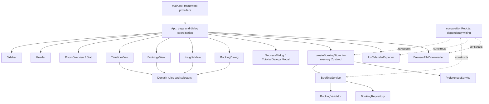

# Architecture and SOLID in KMITL Room Booking

## Technology Stack and Rubric Compatibility

The project is implemented using **React 18 and TypeScript**, with Vite, Zustand, React Router, Tailwind CSS v4, Motion, and Radix Dialog. It remains a browser application; it has not been migrated to Python.

SOLID principles are language-independent object-oriented design principles. TypeScript interfaces, classes, modules, and constructor dependency injection demonstrate the same architectural ideas. React function components handle presentation; classes are used where infrastructure contracts and replaceable implementations improve clarity.

Python-specific conventions such as **PEP 8 are not directly applicable** because the implementation language is TypeScript. This project does **not** claim Python or PEP 8 compliance. It uses TypeScript conventions: PascalCase components/classes/interfaces, camelCase functions and variables, strict typing, focused modules, and consistent Prettier formatting. These are compatible with common ESLint-style conventions; ESLint itself is not configured. The architecture, responsibility separation, coupling, cohesion, and SOLID evaluation criteria are addressed by the implementation and tests. An instructor must decide whether a language-specific assessment condition permits this equivalent demonstration.

| Python concept in the rubric     | TypeScript/React equivalent in this project                                                          |
| -------------------------------- | ---------------------------------------------------------------------------------------------------- |
| Python modules/packages          | ES modules and `domain/`, `services/`, `repositories/`, `components/` folders                        |
| Classes with instance attributes | TypeScript classes with constructor-injected, private readonly dependencies                          |
| Abstract base class / protocol   | Structural interfaces: `BookingRepository`, `BookingValidator`, `StorageAdapter`, `CalendarExporter` |
| Type annotations                 | TypeScript interfaces, unions, function types, and `strict: true`                                    |
| Inheritance / substitutability   | Implementations satisfy shared interface contracts; composition is preferred to inheritance          |
| Unit tests / pytest              | Vitest unit and service/repository integration tests                                                 |
| PEP 8 naming and formatting      | TypeScript naming conventions and Prettier; **not PEP 8 compliance**                                 |
| Dependency injection             | Constructor arguments supplied in `compositionRoot.ts`                                               |
| UI/view class                    | React function component with typed props and local interaction state                                |

## System architecture overview

The app uses a small layered architecture, with a composition root for production wiring. It starts with an empty repository, reads existing browser data if present, and only loads sample bookings on explicit request.

```text
src/
  main.tsx                   React root and framework providers
  App.tsx                    Page composition and UI coordination
  compositionRoot.ts         Concrete production dependency wiring
  components/                Focused React UI components
  types/                     Booking/room models and small contracts
  domain/                    Booking rules, room data, selectors, factories
  services/                  Booking use cases, calendar serialization, preferences, download adapter
  security/                  Shared runtime input and persisted-data boundary checks
  repositories/              Storage adapters and booking persistence implementations
  state/                     In-memory Zustand adapter for use-case results
  utils/                     Date/time formatting and class-name utility
  domain.ts                  Compatibility exports for original consumers/tests
  store.ts                   Compatibility export of the composed store
```

### Layers and dependency direction

1. **Presentation:** `App` composes page components. Components own interaction state such as draft fields, drag selection, filters, and dialog visibility. They do not write booking data to localStorage.
2. **Application:** `BookingService` coordinates save, edit, cancel, demo, and clear operations. It reads the latest repository snapshot, applies domain policy, and persists successful results before exposing them to state.
3. **Domain:** `bookingRules.ts` defines validation, conflict detection, and cancellation policy. `selectors.ts` handles availability/filtering, booking groups, and statistics. No React, Zustand, DOM, or localStorage dependency is present in the domain.
4. **Infrastructure:** repositories serialize snapshots through `StorageAdapter`. `BrowserStorageAdapter` accesses browser storage. `BrowserFileDownloader` owns DOM/Blob/object URL download behavior. `IcsCalendarExporter` only generates calendar file data.
5. **Composition:** `compositionRoot.ts` constructs concrete dependencies. `createBookingStore` adapts service results to React-facing state; it does not use Zustand persistence middleware.

Services use interfaces from `types/contracts.ts`. Concrete adapters depend inward on these contracts. The composition root is intentionally allowed to import concrete implementations. The React coordinator imports composed dependencies, while the business service does not know how they were constructed.

## Component responsibilities

| Component/module                  | Responsibility                                                                                                             |
| --------------------------------- | -------------------------------------------------------------------------------------------------------------------------- |
| `main.tsx`                        | Mount React, error boundary, router, and reduced-motion configuration                                                      |
| `App`                             | Compose the current page, connect store actions, coordinate dialogs, preferences, and notifications                        |
| `Sidebar`, `Header`               | Workspace navigation, mock role selection, theme/help controls                                                             |
| `RoomOverview`, `Stat`            | Room summary, hero, and reusable metric display                                                                            |
| `TimelineView`                    | Search/filter interactions, half-hour timeline, drag/keyboard selection; delegates filtering/conflicts to domain functions |
| `BookingsView`                    | Booking groups/cards and callbacks for edit, duplicate, cancel, share, and export                                          |
| `InsightsView`                    | Render domain-computed booking statistics and peak usage chart                                                             |
| `BookingDialog`                   | Draft form, summary, and error presentation; calls injected validation/save callbacks                                      |
| `Modal`                           | Radix dialog accessibility, focus management, and Motion transitions                                                       |
| `SuccessDialog`, `TutorialDialog` | Booking confirmation and first-use guidance                                                                                |
| `ErrorBoundary`                   | Rendering failure fallback and reload action                                                                               |
| `createBookingStore`              | Adapt successful use-case results to in-memory UI state and expose action errors                                           |

Small UI operations such as changing a filter or opening a dialog remain local. App-level chrome and a generic confirmation dialog remain in `App`; extracting every element would increase indirection without improving the design.

## Class and interface responsibilities

| Abstraction / class                        | Contract and responsibility                                                                                      |
| ------------------------------------------ | ---------------------------------------------------------------------------------------------------------------- |
| `BookingRepository`                        | Read a detached booking snapshot and synchronously replace the snapshot; failures throw                          |
| `LocalStorageBookingRepository`            | Decode/check the saved envelope and persist bookings through a storage abstraction                               |
| `MemoryBookingRepository`                  | Equivalent repository behavior using detached in-memory copies for tests                                         |
| `StorageAdapter`                           | Get a string or null; set a string; storage failures propagate                                                   |
| `BrowserStorageAdapter`                    | Delegate storage operations to a browser Storage supplier                                                        |
| `MemoryStorageAdapter`                     | Store string values in a Map; useful for repository tests                                                        |
| `BookingValidator`                         | Return the first user-facing validation error, or an empty string                                                |
| `BookingRulesValidator`                    | Evaluate ordered, injectable `BookingRule` functions against an injected clock                                   |
| `BookingService`                           | Coordinate repository snapshots, rules, IDs, and booking commands                                                |
| `Clock`                                    | Supply the current date, allowing deterministic policy/export tests                                              |
| `CalendarExporter`                         | Convert a booking to file metadata and content                                                                   |
| `IcsCalendarExporter`                      | Escape text and serialize Thailand-local booking times as UTC calendar timestamps                                |
| `FileDownloader` / `BrowserFileDownloader` | Deliver serialized file data through browser APIs                                                                |
| `PreferencesService`                       | Persist optional theme/tutorial/role preferences independently of bookings; tolerate disabled preference storage |

## High Cohesion

Each module groups behavior for one reason to change. Booking policies live together in `bookingRules.ts`; a change in the cancellation cutoff does not require editing a React card. Storage-envelope handling lives in the repository; form presentation lives in `BookingDialog`. Calendar text escaping and timestamps live in the exporter, while DOM download mechanics live in the downloader. Timeline interaction state is owned by the timeline rather than the entry point.

## Low Coupling

`BookingService` receives interfaces rather than constructing browser storage. The store receives a service and preferences instance rather than instantiating infrastructure. UI components receive typed values and callbacks. Repository, validation, and exporter tests run without a browser. Production wiring is explicit in one location, so swapping a synchronous repository does not change the use-case algorithm.

Some coupling is intentional: room capacity rules use the fixed domain room catalog; routing/presentation remain React-specific; persistence retains the legacy envelope for compatibility. A future asynchronous server repository requires an explicit asynchronous contract rather than pretending it is a synchronous drop-in replacement.

## SOLID applied

### Single Responsibility Principle (SRP)

The original entry point mixed layout, forms, filtering, persistence coordination, validation, and export. `main.tsx` now only mounts the application. Components render specific features, rules validate, the repository persists, and the exporter serializes. Responsibility boundaries follow reasons to change, not one class per function.

### Open/Closed Principle (OCP)

The validator accepts an ordered list of `BookingRule` functions. New policy is added by passing another rule when constructing the validator, without changing its evaluation loop or `BookingService`. Rule ordering deliberately determines which error the user sees first. The extension test in `domain/bookingRules.test.ts` proves that an extra policy can be added independently.

### Liskov Substitution Principle (LSP)

`MemoryBookingRepository` and `LocalStorageBookingRepository` satisfy the same observable contract: empty initial state, detached snapshots, replacement semantics, and compatible error behavior. The **same contract tests and service workflows run against both implementations** in `repositories/bookingRepository.test.ts`. Similarly, both storage adapters are tested for missing-key and overwrite semantics.

TypeScript's `implements` is a compile-time check, not a proof of semantic substitutability. The behavioral tests provide the additional evidence. Different storage availability is permitted: failures throw according to the contract and are handled by the service/store.

### Interface Segregation Principle (ISP)

No single interface combines storage, booking operations, validation, calendar export, downloads, and preferences. `BookingRepository` only exposes snapshots, `StorageAdapter` only exposes string storage, and `CalendarExporter` only exposes serialization. The service does not depend on export/download methods; the exporter does not need the repository. Consumers are not required to implement unrelated methods.

### Dependency Inversion Principle (DIP)

`BookingService` depends on `BookingRepository`, `BookingValidator`, `Clock`, and an ID function. Its source contains no `localStorage`, `window`, `document`, or Zustand calls. `LocalStorageBookingRepository` depends on `StorageAdapter`. The composition root supplies concrete implementations, and tests supply memory adapters and fixed clocks.

## Important code examples

### 1. Extensible validation (actual implementation)

From `src/domain/bookingRules.ts`:

```typescript
export class BookingRulesValidator implements BookingValidator {
  constructor(
    private readonly rules: readonly BookingRule[] = defaultBookingRules,
    private readonly clock: Clock = systemClock,
  ) {}

  validate(input: BookingInput, bookings: readonly Booking[], editingId?: string): string {
    const context: ValidationContext = { bookings, editingId, now: this.clock.now() };
    for (const rule of this.rules) {
      const error = rule(input, context);
      if (error) return error;
    }
    return '';
  }
}
```

This demonstrates SRP (evaluate policy), OCP (inject additional rules), and DIP (inject time). Rules include real calendar-date checks, future start, half-hour operating slots, required details, email, phone, capacity, and conflicts. Cancelled bookings do not block time, and edits exclude their own ID while still checking other reservations.

### 2. Dependency injection (actual production wiring)

From `src/compositionRoot.ts`:

```typescript
const storage = new BrowserStorageAdapter();
const repository = new LocalStorageBookingRepository(storage);
const validator = new BookingRulesValidator();
export const preferences = new PreferencesService(storage);
const service = new BookingService(repository, validator, systemClock, () => crypto.randomUUID());
export const useStore = createBookingStore(service, preferences);
```

The constructor in `src/services/bookingService.ts` accepts abstractions:

```typescript
constructor(
  private readonly repository: BookingRepository,
  private readonly validator: BookingValidator,
  private readonly clock: Clock,
  private readonly nextId: () => string,
) {}
```

The service never constructs its own repository. Its cancellation method checks `canCancel` before writing, so the UI button is not the only policy gate.

## Component diagram



## Class/interface diagram


`CalendarFile` is the filename/content/MIME metadata interface returned by `CalendarExporter`. The ID factory is a function dependency, not a separate class. `BookingRule` is a function type, not a class hierarchy.

## Booking data flow diagram

```mermaid
sequenceDiagram
  actor User
  participant UI as BookingDialog
  participant Store as Zustand actions
  participant Service as BookingService
  participant Rules as BookingValidator
  participant Repo as BookingRepository
  participant Storage as StorageAdapter
  User->>UI: Enter room, date, times and details
  UI->>Store: validate(draft, editingId)
  Store->>Service: validate(draft, editingId)
  Service->>Repo: getAll()
  Repo->>Storage: getItem(legacy key)
  Storage-->>Repo: Saved envelope or null
  Repo-->>Service: Booking snapshot
  Service->>Rules: validate(input, snapshot, editingId)
  Rules-->>UI: Error or empty string (through service/store)
  User->>UI: Confirm summary
  UI->>Store: save(input, editingId)
  Store->>Service: save(input, editingId)
  Service->>Repo: getAll() again
  Service->>Rules: Revalidate against latest snapshot
  alt Valid input and successful write
    Service->>Repo: replaceAll(updated snapshot)
    Repo->>Storage: setItem(serialized envelope)
    Storage-->>Service: Write completes (through repository)
    Service-->>Store: Successful booking result
    Store-->>UI: Publish state and show success
  else Policy error or storage failure
    Service-->>Store: User-facing error; no successful state update
    Store-->>UI: Render error and retain existing in-memory bookings
  end
```

The second validation is intentional: the summary is not permission to bypass policy at save time. Cancellation follows the same service/repository boundary and checks **more than 24 hours** before start. Demo creation is an explicitly separate fixture operation and intentionally permits showcasing historical dates.

## Persistence compatibility and error handling

- Bookings keep the existing `kmitl-booking-v1` key and `{ state: { bookings, ... }, version: 0 }` envelope. Existing bookings and unknown fields in `state` are retained.
- The repository preserves legacy `state.role`; `PreferencesService` reads it as a fallback. Subsequent role choices use the independent `kmitl-role` key.
- Theme and tutorial continue using `kmitl-dark` and `kmitl-tour` through the preference service.
- Invalid JSON, invalid booking shapes, and unsupported versions are reported; the original value is not silently overwritten. Recovery from corrupt storage currently requires manually repairing/removing that key after preserving any needed data.
- A failed write does not update the UI as if the booking succeeded. Service errors are returned to the form/action and exposed by the store. Optional preference storage failures are tolerated for the session.
- The React error boundary still handles rendering failures. Calendar download and clipboard failures produce notifications.

## Verification and regression coverage

Run:

```sh
npm run build
npm test
npm run test:e2e
npm run format:check
```

Tests include valid bookings, capacity boundaries, invalid dates/email/phone/times, overlapping and adjacent intervals, cancelled bookings, self-edits and conflicting edits, exact cancellation cutoff, missing IDs, demo/reset, repository/adapter contracts, legacy data/role reload, corrupt data, write failures, and timezone-correct calendar text. The original six domain tests and eight desktop/mobile browser checks remain present.

Browser checks cover room searching, demo/reset, persistence, creation/edit/cancel, ICS downloads, keyboard booking, drag selection, capacity filtering, dark mode, and no horizontal page overflow. These are automated checks, not a claim of full accessibility certification or coverage of every device.

## Design decisions and trade-offs

- **Composition over inheritance:** interfaces describe replaceable boundaries; React components remain functions. Classes are used for meaningful service/adapter lifecycles.
- **Small synchronous contracts:** appropriate for a single-browser student prototype; a remote repository needs async use cases, loading state, and transactional server conflict checks.
- **Readable rule pipeline:** ordered first-error messages are easier to explain than a generic validation framework. The validator is extensible without decorators or a DI container.
- **Failure visibility:** no silent fallback to an empty writable repository when saved booking data cannot be read. This favors preserving user data over automatic reset.
- **Compatibility exports:** `src/domain.ts` and `src/store.ts` remain thin entry points so original tests/imports keep working. New code imports focused modules.
- **Existing UI retained:** styling, Thai copy, fixed room photos, responsive layout, animation primitives, and mock authentication remain intact.

## Remaining limitations and future refactoring

1. Authentication is a mock role selector; no institutional sign-in, authorization, server approval workflow, or email delivery exists.
2. LocalStorage is per browser and origin. No cross-device consistency, cross-tab live subscription, or atomic protection against concurrent browser writes is provided.
3. The native date picker follows browser locale; Thai captions use Buddhist years. Date grouping uses the existing date-fns/browser calendar semantics.
4. Wi-Fi is unverified in the supplied catalog, so the Wi-Fi filter yields no verified rooms.
5. PWA metadata exists, but offline caching/service-worker behavior is not implemented.
6. Calendar output preserves the prototype's basic event fields; advanced recurrence, invitation delivery, can be added independently to the exporter. UTF-8 line folding and safe download filenames are now implemented and tested.
7. If requirements grow, extract a dedicated room-catalog interface, split timeline filters/rows further, add async repository contracts and server transactions, and add ESLint/CI/accessibility checks. Avoid adding these abstractions until there is a concrete need.

## Suggested oral presentation explanation

> We retained React and TypeScript because this project is an interactive browser application with an existing React codebase. SOLID is independent of programming language: our components have focused responsibilities, our validation rules are extensible, and our booking service receives repository and validator interfaces through dependency injection. We prove substitutability by running the same repository contract tests against memory and localStorage implementations. We do not claim Python or PEP 8 compliance; we demonstrate the architecture criteria using strict TypeScript, modular design, and consistent TypeScript formatting.

Thai version:

> โครงการนี้ใช้ React และ TypeScript เพราะเป็นเว็บแอปที่มีหน้าจอแบบโต้ตอบและมีโค้ด React อยู่แล้วครับ/ค่ะ หลัก SOLID ไม่ได้จำกัดเฉพาะ Python เราแยกหน้าที่ของ component, validation, service และ persistence ชัดเจน โดยให้ BookingService รับ interface ผ่าน dependency injection และทดสอบว่า repository แบบ memory กับ localStorage ใช้แทนกันได้ตามสัญญาเดียวกัน เราไม่ได้อ้างว่าทำตาม PEP 8 หรือใช้ Python แต่แสดงหลักการออกแบบ สถาปัตยกรรม cohesion และ coupling ด้วย TypeScript ครับ/ค่ะ

## Rubric extension: security and automatic deployment

The additional runtime boundary module is shared by domain validation and repository decoding. It checks input shapes, length limits, saved record structure, unique IDs, and resource bounds; it does not add trusted authorization to browser code. See [Threat Model](threat-model.md), [Secure Coding](secure-coding.md), and [Traceability](traceability-matrix.md).

The production GitHub Pages build selects HashRouter and a configured base path while local/browser builds preserve BrowserRouter. Infrastructure scripts in `deployment/` install and serve the built artifact, send local response headers, and capture smoke evidence. GitHub Actions separates read-only CI, Pages build, privileged deployment, and installed-revision verification. CI/CD execution status must be supported by actual run URLs rather than the presence of YAML.
