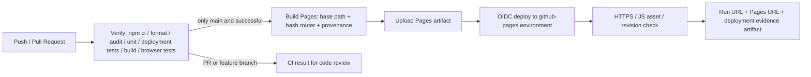

# การติดตั้งอัตโนมัติและ CI/CD

## ช่องทางและหลักฐานที่ต้องแยกกัน

1. **การติดตั้งอัตโนมัติในเครื่อง:** build และคัดลอก artifact ไป `.deployment/current` ด้วยสคริปต์ จากนั้นรัน เซิร์ฟเวอร์ไฟล์เว็บไซต์ และ smoke tests มีผลจริงใน `docs/evidence/local-deployment.json`
2. **GitHub CI:** workflow ตรวจทุก push/PR; ต้องอ้าง GitHub Actions run URL จริงหลัง push
3. **GitHub Pages CD:** หลัง main ผ่าน CI จะสร้าง Pages artifact และ deploy ผ่าน OIDC จากนั้นตรวจ HTTPS URL/JS asset/revision เก็บ `production-deployment-evidence` artifact

Local smoke ที่ผ่านไม่ใช่หลักฐานว่า GitHub CD ผ่านแล้ว URL ที่คาดว่าจะเป็น `https://pootanapat.github.io/smart-campus-booking/` ต้องเปิดตรวจหลัง platform deploy สำเร็จจึงเรียกว่า URL ที่ติดตั้ง

## การติดตั้งอัตโนมัติในเครื่อง

ต้องมี Node.js 24 และ npm ตาม lockfile:

```sh
npm ci
npm test
npm run test:deployment
npm run deploy:local
npm run serve:deployment
```

เปิดอีก terminal:

```sh
npm run smoke:deployment
```

ผลสคริปต์:

- `deploy:local` build ด้วย TypeScript/Vite และติดตั้งเฉพาะ `dist` ลง `.deployment/current` ภายใน workspace
- `serve:deployment` เปิด `http://127.0.0.1:5190` จาก artifact ที่ติดตั้ง ไม่ใช่ Vite dev เซิร์ฟเวอร์
- `smoke:deployment` ตรวจหน้าแรก, JS asset, SPA deep route, room photo, private-path denial และ missing asset พร้อมเขียน JSON หลักฐาน
- `deployment.json` มี environment, เวลา UTC, git revision และ SHA-256 ของ index HTML (ในเครื่อง working tree อาจยังมีการแก้ไข จึงไม่ใช้ git revision อย่างเดียวอ้างว่า artifact ตรง committed tree)

การรัน E2E บน built artifact แทน dev เซิร์ฟเวอร์:

```powershell
$env:E2E_STATIC='1'
npm run test:e2e
```

```sh
E2E_STATIC=1 npm run test:e2e
```

## Workflow จริงใน repository

ไฟล์: `.github/workflows/ci-cd.yml`



### เงื่อนไขผ่านการตรวจ CI

- PR/push ใช้ `contents: read`, ไม่รับ secrets ของ สภาพแวดล้อมเผยแพร่จริง
- `npm ci` ใช้ lockfile, `npm audit --audit-level=high` ตรวจ dependency advisories
- ตรวจ formatting, unit/security tests, Node เซิร์ฟเวอร์ไฟล์เว็บไซต์ test, build และ Playwright desktop/mobile บน built artifact
- เก็บ test output/ภาพหน้าจอ เป็น artifact 14 วัน แม้กรณี test ไม่ผ่าน
- Actions อ้าง immutable SHA; Dependabot เสนอการปรับ dependency/Actions ผ่าน PR

### เงื่อนไขผ่านการติดตั้ง CD

- เฉพาะ ref `refs/heads/main` ที่ไม่ใช่ pull_request และ job `verify` สำเร็จ
- Pages build ใช้ base path จาก `configure-pages` และ `VITE_ROUTER_MODE=hash` เพื่อรองรับ repo subpath/deep navigation บน static Pages
- Pages build เขียน `dist/deployment.json` พร้อม SHA/runId/repository; ไม่ฝัง token
- deploy job เท่านั้นที่มี `pages: write` และ `id-token: write`
- post-deploy check เปิด HTTPS, ตรวจ root/JS asset และ revision ตรง `GITHUB_SHA`
- เก็บ `docs/evidence/pages-deployment.json` เป็น artifact 30 วัน ไม่มีการสร้างไฟล์นี้ปลอมเมื่อยังไม่ deploy

## เปิดใช้งานบน GitHub ครั้งแรก

Repository: [Pootanapat/smart-campus-booking](https://github.com/Pootanapat/smart-campus-booking)

1. Push branch และเปิด PR ให้สมาชิก review
2. เจ้าของ repo ไป Settings → Pages → Build and deployment → Source: **GitHub Actions**
3. ตั้ง branch protection และ environment ให้ deploy main ได้ตาม policy ของทีม
4. Merge PR เมื่อพร้อม จากนั้นตรวจหน้า [Actions](https://github.com/Pootanapat/smart-campus-booking/actions)
5. เปิด environment `github-pages` → deployed URL → เปิด `/deployment.json` ใต้ base URL และเทียบ revision กับ commit
6. ดาวน์โหลด artifacts และใส่ run URL/PR URL ในหลักฐานนำเสนอ

ถ้าเปิด environment ให้ต้องมี manual approval จะเป็น continuous delivery ที่รออนุมัติ ไม่ใช่ fully automatic continuous deployment จนกว่าจะอนุมัติ ควรอธิบาย policy ตามที่ตั้งจริง

## รายการตรวจ ผลติดตั้งสำหรับการให้คะแนน

| หลักฐาน                          | แหล่งจริง                                                    |
| -------------------------------- | ------------------------------------------------------------ |
| ผล CI ผ่านของ revision ที่นำเสนอ | GitHub Actions run URL + commit SHA                          |
| ผลขั้นตอนติดตั้ง CD ผ่าน         | บันทึกขั้นตอนและสภาพแวดล้อมที่ติดตั้ง                        |
| เว็บไซต์เปิดได้                  | installed HTTPS URL ที่ action คืนมา                         |
| revision ตรงกัน                  | Pages `deployment.json` และ post-deploy JSON artifact        |
| ใช้งานได้หลังติดตั้ง             | เบราว์เซอร์ demo booking/edit/cancel และรูปห้องโหลดได้       |
| ใช้งาน failure path ได้          | invalid booking / XSS text / corrupt storage demonstration   |
| หลักฐานการติดตั้งในเครื่อง       | `docs/evidence/local-deployment.json` — แยกจาก ระยะไกล proof |

## การย้อนกลับรุ่น และข้อจำกัด

การย้อนกลับรุ่น ที่เสนอ: revert commit ที่มีปัญหาผ่าน PR แล้วให้ CI/CD ติดตั้งใหม่ หรือใช้ run ที่ผ่านสำหรับ revision เดิมตาม policy ของทีม **ยังไม่ได้ทำ rollback จริงในแพลตฟอร์ม** จึงไม่อ้างว่าทดสอบแล้ว

Local Node เซิร์ฟเวอร์ ส่ง security headers ที่ทดสอบไว้ แต่ GitHub Pages เป็นอีก host หนึ่ง ไม่มีการนำ Node response headers ไปใช้เอง แอปทั้งหมดเป็น เบราว์เซอร์ ต้นแบบ; CI/CD ไม่เพิ่ม บริการหลังบ้าน authorization, database หรือ multi-user consistency ให้โดยอัตโนมัติ ในเครื่อง installer เป็นตัวอย่างติดตั้ง artifact ไม่ใช่ระบบ release orchestration สำหรับ สภาพแวดล้อมเผยแพร่จริง cluster

## อ้างอิง

- [กระบวนการทำงานกำหนดเองของ GitHub Pages](https://docs.github.com/en/pages/getting-started-with-github-pages/using-custom-workflows-with-github-pages)
- [GitHub Node.js CI](https://docs.github.com/en/actions/tutorials/build-and-test-code/nodejs)
- [การติดตั้งเว็บไซต์ไฟล์คงที่ด้วย Vite](https://vite.dev/guide/static-deploy.html#github-pages)

## หลักฐานที่เกิดขึ้นแล้วในชุดงานนี้

- PR ฉบับร่าง: [#3](https://github.com/Pootanapat/smart-campus-booking/pull/3)
- GitHub CI สำเร็จบน review branch: [run 41058420995](https://github.com/Pootanapat/smart-campus-booking/actions/runs/41058420995), ตรวจผล metadata ได้จาก [github-ci.json](evidence/github-ci.json)
- Pages-shaped build ทดสอบ ในเครื่อง subpath `/smart-campus-booking/`, รูปห้องทั้ง 5, hash navigation, reload และ brand link จริง: [pages-build-ในเครื่อง.json](evidence/pages-build-ในเครื่อง.json)
- Remote CD สำเร็จจริง: [run 41059099454](https://github.com/Pootanapat/smart-campus-booking/actions/runs/41059099454), URL ที่ติดตั้ง https://pootanapat.github.io/smart-campus-booking/, revision `6d753268cb1d93a5a64464b19acfcc07785fcdc2` — [artifact JSON](evidence/pages-deployment.json), [live เบราว์เซอร์ checks](evidence/live-เบราว์เซอร์.json)

Pages เปิดเป็น workflow source แล้ว และ PR #3 merge ตามการอนุมัติของเจ้าของงาน Local installation เป็นหลักฐานคนละ environment กับผล ระยะไกล ข้างต้น ภาพ [desktop](evidence/live-desktop.png) และ [mobile](evidence/live-mobile.png) เก็บจาก deployed URL จริง หลักฐานนี้ผูกกับ revision/run ที่ระบุ; เอกสารอาจถูกปรับหลัง deployment นั้น และ workflow จะสร้างหลักฐานใหม่ต่อการ deploy ทุกครั้ง
