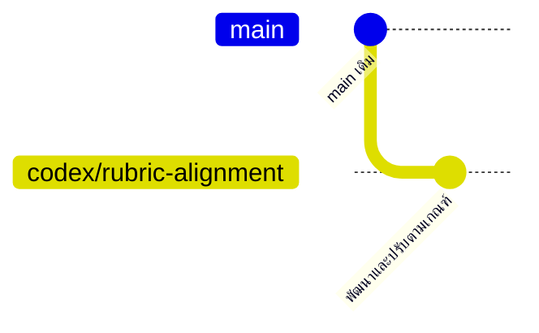

# กระบวนการทำงานร่วมกันของทีม และหลักฐาน Git

Repository: [Pootanapat/smart-campus-booking](https://github.com/Pootanapat/smart-campus-booking)

## ประวัติที่ตรวจพบจริงก่อนชุดปรับเกณฑ์นี้

ตรวจจาก ระยะไกล `main` ที่ commit `9598b8d` ไม่ใช่ประวัติที่สร้างย้อนหลังเพื่อให้คะแนน

| Commit                                                                       | Author ตาม Git | Message                                            | สิ่งที่ใช้ยืนยันได้                                |
| ---------------------------------------------------------------------------- | -------------- | -------------------------------------------------- | -------------------------------------------------- |
| [9598b8d](https://github.com/Pootanapat/smart-campus-booking/commit/9598b8d) | Pootanapat     | Add files via upload                               | เพิ่มไฟล์อ้างอิง ไม่ใช่หลักฐาน app feature ทุกส่วน |
| [2fc34ee](https://github.com/Pootanapat/smart-campus-booking/commit/2fc34ee) | ืNattaphop     | Update README.md                                   | แก้ README                                         |
| [18cbb12](https://github.com/Pootanapat/smart-campus-booking/commit/18cbb12) | Chaonaiisa     | Update team member details in README               | แก้ข้อมูลทีม                                       |
| [e13ecef](https://github.com/Pootanapat/smart-campus-booking/commit/e13ecef) | Napat 080      | เพิ่มชื่อส่วนหน้าที่ของ Napat                      | แก้ README                                         |
| [23ec1bc](https://github.com/Pootanapat/smart-campus-booking/commit/23ec1bc) | gun657         | Update README to include Teekathat for QR Check-in | แก้แผนทีมใน README                                 |
| [3f15d29](https://github.com/Pootanapat/smart-campus-booking/commit/3f15d29) | Pootanapat     | Add Django-related files to .gitignore             | ตั้งค่า ignore ตามแผนเดิม                          |

มี 5 author ที่ตรวจพบในประวัติเดิม แต่ไม่อนุมานว่าเป็น feature contribution ครบ 6 คน และไม่อ้างชื่อ author ว่าคือผู้ review โดยอัตโนมัติ การปรับครั้งนี้ทำด้วยความช่วยเหลือของ Codex; commit ผู้ใช้หนึ่งคนไม่ใช่หลักฐานการกระจายงานของทั้งทีม

## แนวทางแยกสาขางานตามคุณลักษณะ (Feature Branching)



ภาพนี้อธิบาย branch สำหรับชุดงานปัจจุบัน ไม่วาด merge/review ที่ยังไม่ได้เกิดขึ้น

- `main`: revision ที่ผ่าน CI และพร้อมให้ Pages CD ติดตั้ง
- `feature/<short-topic>`: งานของสมาชิก เช่น `feature/room-filter-tests`
- `fix/<short-topic>`: แก้ปัญหาที่มี test แสดงก่อน/หลัง
- `docs/<short-topic>`: threat/risk/demo/review evidence
- `codex/rubric-alignment`: branch ชุดปรับปัจจุบัน แยกจาก main เพื่อเปิด review

## กระบวนการที่ทีมควรทำจริง

1. เปิด issue ระบุ FR/SR/T/R ที่เกี่ยวข้องและผู้รับผิดชอบ
2. สมาชิกแตก branch จาก main ล่าสุด ทำงานที่ได้รับมอบหมาย และ commit ด้วยบัญชีตนเอง
3. เปิด PR พร้อม problem/result, code changes, test output และ risk/trade-off ใช้ `.github/pull_request_template.md`
4. ให้เพื่อนอย่างน้อย 1 คน review โดยดู correctness, responsibilities/SOLID, unsafe data handling และ tests
5. ผู้เขียนแก้ feedback; ผู้ตรวจโค้ด ตรวจ revision ล่าสุดและให้ review จริง
6. CI ต้องผ่านก่อน merge จากนั้น Pages CD ติดตั้ง revision บน main และเก็บ URL ที่ติดตั้ง/artifact

แนะนำให้ตั้ง branch protection ของ main: require pull request, 1 approval, required status check `ตรวจคุณภาพ ความปลอดภัย และเบราว์เซอร์`, ห้าม force push และห้ามลบ branch หลัก การมีเอกสารนี้ยังไม่ได้แปลว่าเปิด protection แล้ว

## ข้อความ commit ที่สื่อความหมาย

ตัวอย่างข้อความสำหรับงานที่จะทำจริง:

```text
feat(booking): reject requests exceeding room capacity
fix(calendar): escape event delimiters and fold UTF-8 lines
test(security): verify stored XSS is rendered as text
docs(threats): map local storage tampering to open authorization risk
ci: verify production build before publishing GitHub Pages
```

ตัวอย่างไม่ใช่ commit ที่อ้างว่าเกิดขึ้นแล้ว ห้ามเปลี่ยนชื่อ author, backdate หรือแบ่ง commit เปล่าเพื่อแสดง contribution

## ชุดงาน เสนอสำหรับทีม 6 คน

| Work package           | งานที่สามารถรับผิดชอบและเปิด PR จริง                      | หลักฐานที่ต้องเก็บ                     |
| ---------------------- | --------------------------------------------------------- | -------------------------------------- |
| 1 Booking/domain       | ตรวจ overlap/จุดตัดเวลายกเลิก และเพิ่มกรณี edge ที่ยังขาด | commit/test/PR/review URL              |
| 2 Persistence/security | วิเคราะห์ valid tampering และออกแบบ future auth boundary  | threat/repository test PR              |
| 3 UI/accessibility     | ทดสอบ form/keyboard/mobile และแก้ปัญหาที่พบ               | issue/ภาพหน้าจอ/เบราว์เซอร์ test PR    |
| 4 Calendar/export      | ตรวจ timezone/long Thai text และ calendar client behavior | test/demo/PR                           |
| 5 CI/CD                | เปิด Pages/branch protection และตรวจ installed revision   | run URL/commit SHA/deployment artifact |
| 6 QA/presentation      | ไล่ traceability และซ้อม failure/demo scenarios           | review record/demo checklist PR        |

ตารางนี้เป็นข้อเสนอ ไม่ใช่การอ้างว่าสมาชิกทำแล้ว และไม่แทนรายชื่อ/บทบาทที่ทีมตกลงจริง

## คำสั่งเก็บหลักฐาน

```sh
git log --graph --oneline --decorate --all
git log --format="%h | %an | %s"
git shortlog -sn --all
```

เก็บหน้า PR ที่มี review comments/changes requested/approval จริง และหน้า Actions run ที่ผูกกับ commit นั้น ตัวเลข commit อย่างเดียวไม่บอกคุณภาพหรือปริมาณงาน ควรให้ผู้รับผิดชอบอธิบายสิ่งที่ตนออกแบบ แก้ และตรวจสอบได้
