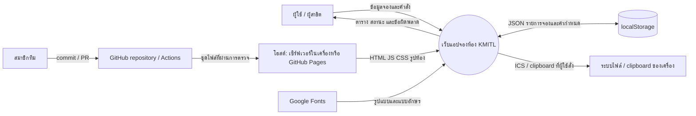
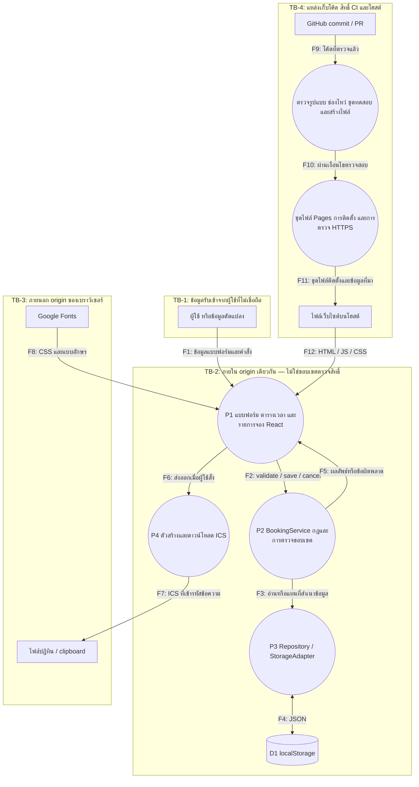
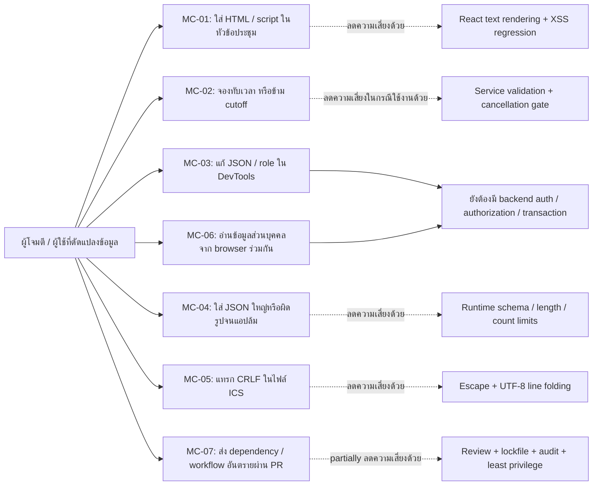

# วิเคราะห์ภัยคุกคามของระบบจองห้องประชุม KMITL

## 1. ขอบเขตและสมมติฐาน

ระบบปัจจุบันเป็น SPA บน React/TypeScript ผู้ใช้กรอกข้อมูลแล้วเก็บใน localStorage ของ เบราว์เซอร์/origin เดียว ไม่มี API บริการหลังบ้าน, database, password, session token หรือ การตรวจสิทธิ์ฝั่งเซิร์ฟเวอร์ การเลือก นักศึกษา/บุคลากร/ผู้ดูแลระบบ เป็น **บทบาทจำลอง** เท่านั้น ผู้ใช้ที่เปิด DevTools หรือมี script รันใน origin เดียวกันสามารถแก้ข้อมูลที่รูปแบบถูกต้องได้

การวิเคราะห์ครอบคลุม เบราว์เซอร์, การจัดเก็บ, การส่งออกปฏิทิน, การให้บริการไฟล์เว็บไซต์ และ ห่วงโซ่ซอฟต์แวร์ ของ CI/CD ขอบเขต สภาพแวดล้อมเผยแพร่จริง ที่เสนอคือ GitHub Pages; เซิร์ฟเวอร์ไฟล์เว็บไซต์ในเครื่อง มี response headers เพิ่มเติมซึ่ง Pages ไม่รับ configuration เดียวกันโดยอัตโนมัติ

## 2. รายการทรัพย์สิน (Asset List)

ตีความ “Asses List” ในเกณฑ์เป็น **รายการทรัพย์สิน** ควรยืนยันคำศัพท์กับอาจารย์

| ID   | ทรัพย์สิน                              | CIA ที่สำคัญ               | เหตุผล                                                   |
| ---- | -------------------------------------- | -------------------------- | -------------------------------------------------------- |
| A-01 | รายการจอง: ห้อง/เวลา/หัวข้อ/สถานะ      | Integrity, Availability    | ข้อมูลผิดทำให้เห็นห้องว่างหรือจองซ้ำผิด                  |
| A-02 | ชื่อ อีเมล โทรศัพท์ หน่วยงาน           | Confidentiality            | เป็นข้อมูลส่วนบุคคล จึงใช้ข้อมูลสมมติในการสาธิต          |
| A-03 | กฎ เวลาทับซ้อน/ความจุ/การยกเลิก        | Integrity                  | ควรใช้กฎเดียวกันในการกรอกและบันทึก                       |
| A-04 | ซอร์สโค้ดและ lockfile, ชุดไฟล์ที่สร้าง | Integrity                  | โค้ดหรือ dependency เปลี่ยนอาจเพิ่มพฤติกรรมอันตราย       |
| A-05 | GitHub token/OIDC และ สิทธิ์ติดตั้ง    | Confidentiality, Integrity | ผู้มีสิทธิ์ deploy สามารถเปลี่ยนเว็บไซต์                 |
| A-06 | รายงาน CI, revision, URL ที่ติดตั้ง    | Integrity, Availability    | เป็นหลักฐานว่าทดสอบและติดตั้ง revision ใด                |
| A-07 | ไฟล์ ICS / การส่งออกไปยังคลิปบอร์ด     | Confidentiality, Integrity | เป็นช่องทางส่งข้อมูลออกจาก เบราว์เซอร์ ที่ผู้ใช้เลือกเอง |

## 3. DFD ระดับภาพรวม

## 4. DFD ระดับ 1 และ ขอบเขตความเชื่อถือ

การตรวจ schema ที่ F4 ลดข้อมูลผิดรูป แต่ไม่ป้องกันการแก้ไข JSON ที่ผ่าน schema โดยผู้ใช้เอง ไม่มีการอ้างว่า TB-2 แบ่งสิทธิ์ผู้ใช้จริง

## 5. กรณีใช้งานผิดวัตถุประสงค์

| กรณีใช้งานผิดวัตถุประสงค์ | เงื่อนไขตั้งต้นและวิธีทดสอบ                                       | พฤติกรรมที่คาดหวัง                                            | ขอบเขตที่ยังไม่แก้                                              |
| ------------------------- | ----------------------------------------------------------------- | ------------------------------------------------------------- | --------------------------------------------------------------- |
| MC-01                     | ชื่อประชุมเป็น ``                          | แสดงเป็นข้อความ ไม่มี element หรือ script ถูกสร้าง            | ถ้าอนาคตใช้ raw HTML ต้องประเมินใหม่                            |
| MC-02                     | ส่ง overlap/แก้รายการชนอีก ID/ยกเลิกตรง 24h ผ่าน service          | ส่ง error ไม่บันทึก                                           | เขียน localStorage โดยตรงยังข้าม business rules ได้             |
| MC-03                     | เปลี่ยน status/role ใน DevTools                                   | enum/schema ผิดถูกปฏิเสธ; role ไม่ใช่สิทธิ์จริง               | valid JSON tampering ยังทำได้                                   |
| MC-04                     | JSON เสีย, room ID ไม่รู้จัก, duplicate IDs, >1000 รายการ, >2 MiB | ไม่ parse ข้อมูลใหญ่เกิน / ไม่ overwrite ต้นฉบับ / แจ้ง error | การยึด เบราว์เซอร์ storage ทั้ง origin โดยผู้ใช้เองยังเป็นไปได้ |
| MC-05                     | ใส่ newline และ `BEGIN:VEVENT` ในหัวข้อ                           | อยู่ใน text field ที่ escape; มี event เดียว                  | การส่งไฟล์ให้ผู้อื่นเป็นความรับผิดชอบในการเลือกข้อมูล           |
| MC-06                     | ใช้ เบราว์เซอร์ profile ร่วมกับผู้อื่น                            | สาธิตด้วยข้อมูลสมมติและใช้ reset                              | ยังไม่มีการแยก identity/ownership                               |
| MC-07                     | เปลี่ยน workflow หรือ dependency                                  | CI/audit และ review เป็น gate, deploy เฉพาะ main              | ผู้ดูแล repo/credential ที่ถูกยึดยังเป็นความเสี่ยง              |

## 6. STRIDE และ ข้อกำหนดความปลอดภัย

| Threat | STRIDE                             | ทรัพย์สิน / การไหลข้อมูล | การใช้ผิดวัตถุประสงค์                                        | ข้อกำหนด     | ความเสี่ยง |
| ------ | ---------------------------------- | ------------------------ | ------------------------------------------------------------ | ------------ | ---------- |
| T-01   | Tampering                          | A-01/A-03, F1–F5         | invalid input/overlap/จุดตัดเวลายกเลิก bypass ผ่านคำสั่ง app | SR-01, SR-05 | R-01       |
| T-02   | Tampering / DoS                    | A-01, F4                 | malformed/oversized/duplicate data                           | SR-02        | R-02       |
| T-03   | Information Disclosure / Tampering | A-02, F1/F12             | XSS ผ่านหัวข้อที่นำมาแสดง                                    | SR-03, SR-07 | R-03       |
| T-04   | Tampering                          | A-07, F6/F7              | ICS property/event injection                                 | SR-04        | R-04       |
| T-05   | Spoofing / Elevation of Privilege  | A-01/A-02, TB-2          | แก้ role / valid JSON / จัดการรายการคนอื่น                   | SR-08        | R-05       |
| T-06   | Information Disclosure             | A-02, D1/F7              | shared เบราว์เซอร์ / external script อ่าน localStorage       | SR-09        | R-06       |
| T-07   | Tampering / Elevation of Privilege | A-04/A-05, F9–F12        | dependency/workflow เปลี่ยน artifact                         | SR-06        | R-07       |
| T-08   | Repudiation                        | A-01/A-06                | ปฏิเสธการแก้ไขโดยไม่มี audit log                             | SR-10        | R-08       |
| T-09   | Tampering                          | A-01, F3/F4              | concurrent tabs เขียนชนกัน                                   | SR-11        | R-09       |

### ข้อกำหนดที่นำไปทดสอบได้

| ID    | ข้อกำหนดและเงื่อนไขยอมรับ                                                                                                       | สถานะ                                                                                    |
| ----- | ------------------------------------------------------------------------------------------------------------------------------- | ---------------------------------------------------------------------------------------- |
| SR-01 | ตรวจ ขณะทำงาน type, required fields, ข้อความ ≤200 (notes ≤1000), valid date/time/contact/capacity และ overlap ก่อนบันทึก        | ทำแล้ว ใน domain/service; client-side เท่านั้น                                           |
| SR-02 | ตรวจ schema ของ persisted input, รหัสห้อง/สถานะ/ช่วงเวลา/IDs, จำกัด 1000 รายการและ JSON 2 MiB, ไม่ทับข้อมูลเสีย                 | ทำแล้ว ใน repository                                                                     |
| SR-03 | user text แสดงผ่าน React text nodes; ไม่สร้าง HTML ที่ executable จากหัวข้อ                                                     | ทำแล้ว; เบราว์เซอร์ regression test                                                      |
| SR-04 | escape calendar CR/LF และ delimiters, จำกัด filename characters, fold line ไม่เกิน 75 UTF-8 bytes                               | ทำแล้ว; serializer security tests                                                        |
| SR-05 | ยกเลิกได้เมื่อเหลือเวลา >24h และตรวจใน service ไม่พึ่ง disabled button อย่างเดียว                                               | ทำแล้ว; จุดตัดเวลายกเลิก boundary tests                                                  |
| SR-06 | reproducible `npm ci`, audit gate, tests/build ก่อน deploy, SHA-pinned Actions, permissions ต่ำ, ไม่ deploy จาก PR              | configured; ระยะไกล execution ต้องมี Actions evidence                                    |
| SR-07 | ในเครื่อง static deployment ส่ง CSP, nosniff, frame denial, no-referrer, private path denial                                    | ทำแล้ว/tested สำหรับ ในเครื่อง เซิร์ฟเวอร์; **ไม่อ้างว่า Pages ส่ง headers ชุดเดียวกัน** |
| SR-08 | ต้องมี identity/ownership/role authorization ที่ trusted เซิร์ฟเวอร์ ก่อนใช้จริงหลายผู้ใช้                                      | planned / open                                                                           |
| SR-09 | ห้ามเก็บ token/password ใน localStorage; demo ใช้ข้อมูลสมมติ; ออกแบบ data minimization/retention ที่ เซิร์ฟเวอร์ ก่อนข้อมูลจริง | token/password ไม่ได้ใช้; PII protection ยัง ทำบางส่วนและยังไม่ครบ                       |
| SR-10 | audit log ที่ผูกผู้ใช้กับเหตุการณ์และป้องกันการแก้ไขโดยผู้ใช้                                                                   | planned / open                                                                           |
| SR-11 | atomic conflict checks/transactions ที่ เซิร์ฟเวอร์ ป้องกัน concurrent writes                                                   | planned / open                                                                           |

## 7. แหล่งอ้างอิงและการใช้หลักการ

- [OWASP Input Validation Cheat Sheet](https://cheatsheetseries.owasp.org/cheatsheets/Input_Validation_Cheat_Sheet.html): ใช้ ขณะทำงาน checks, allowlisted structured values และขอบเขตความยาว; ส่วนหน้าจอ checks ไม่แทน เซิร์ฟเวอร์ การตรวจสอบข้อมูล
- [OWASP XSS Prevention Cheat Sheet](https://cheatsheetseries.owasp.org/cheatsheets/Cross_Site_Scripting_Prevention_Cheat_Sheet.html): ใช้ framework text การแสดงผล ในบริบทข้อความ ไม่ใช้การบล็อกคำว่า script เป็นการป้องกันหลัก
- [OWASP HTML5 Security Cheat Sheet](https://cheatsheetseries.owasp.org/cheatsheets/HTML5_Security_Cheat_Sheet.html): localStorage อ่านได้จาก JavaScript ใน origin เดียวกัน จึงไม่ใช้เก็บ password/token และไม่ถือเป็น authorization boundary

เอกสารนี้เป็น threat analysis ของ ต้นแบบ ไม่ใช่รายงาน penetration test หรือการรับรองว่าระบบ สภาพแวดล้อมเผยแพร่จริง ปลอดภัยครบถ้วน
