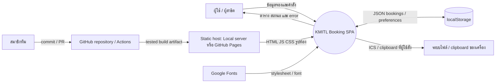
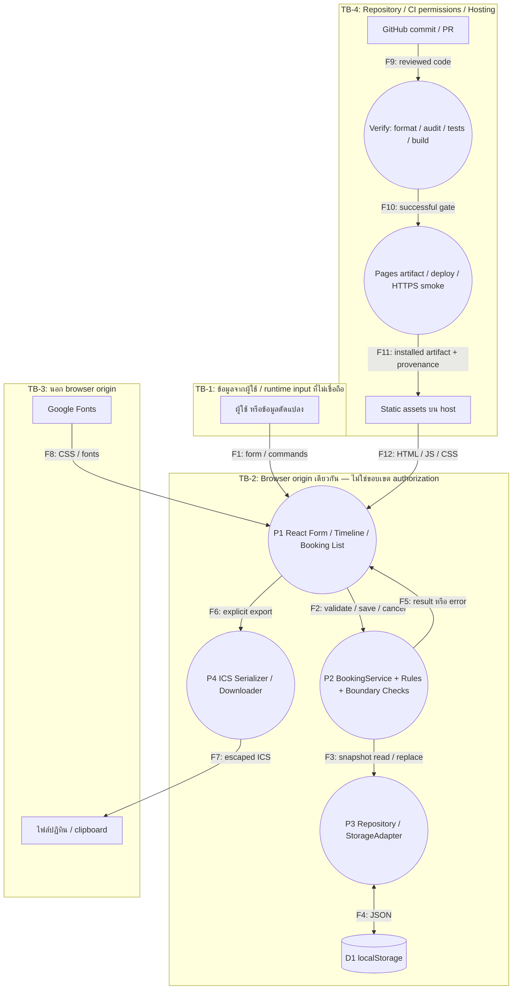
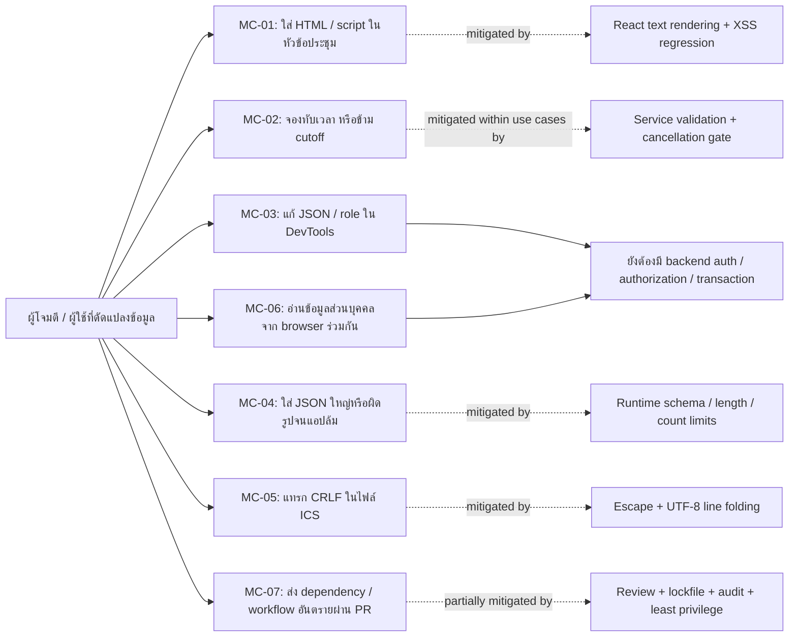

# Threat Analysis — KMITL Room Booking

## 1. ขอบเขตและสมมติฐาน

ระบบปัจจุบันเป็น SPA บน React/TypeScript ผู้ใช้กรอกข้อมูลแล้วเก็บใน localStorage ของ browser/origin เดียว ไม่มี API backend, database, password, session token หรือ server authorization การเลือก Student/Staff/Admin เป็น **mock role** เท่านั้น ผู้ใช้ที่เปิด DevTools หรือมี script รันใน origin เดียวกันสามารถแก้ข้อมูลที่รูปแบบถูกต้องได้

การวิเคราะห์ครอบคลุม browser, การจัดเก็บ, calendar export, static hosting และ supply chain ของ CI/CD ขอบเขต production ที่เสนอคือ GitHub Pages; local static server มี response headers เพิ่มเติมซึ่ง Pages ไม่รับ configuration เดียวกันโดยอัตโนมัติ

## 2. Asset List (รายการทรัพย์สิน)

ตีความ “Asses List” ในเกณฑ์เป็น **Asset List** ควรยืนยันคำศัพท์กับอาจารย์

| ID   | Asset                                       | CIA ที่สำคัญ               | เหตุผล                                               |
| ---- | ------------------------------------------- | -------------------------- | ---------------------------------------------------- |
| A-01 | รายการจอง: ห้อง/เวลา/หัวข้อ/สถานะ           | Integrity, Availability    | ข้อมูลผิดทำให้เห็นห้องว่างหรือจองซ้ำผิด              |
| A-02 | ชื่อ อีเมล โทรศัพท์ หน่วยงาน                | Confidentiality            | เป็นข้อมูลส่วนบุคคล จึงใช้ข้อมูลสมมติในการสาธิต      |
| A-03 | กฎ overlap/capacity/cancellation            | Integrity                  | ควรใช้กฎเดียวกันในการกรอกและบันทึก                   |
| A-04 | source, lockfile, build artifact            | Integrity                  | โค้ดหรือ dependency เปลี่ยนอาจเพิ่มพฤติกรรมอันตราย   |
| A-05 | GitHub token/OIDC และ deployment permission | Confidentiality, Integrity | ผู้มีสิทธิ์ deploy สามารถเปลี่ยนเว็บไซต์             |
| A-06 | รายงาน CI, revision, installed URL          | Integrity, Availability    | เป็นหลักฐานว่าทดสอบและติดตั้ง revision ใด            |
| A-07 | ไฟล์ ICS / clipboard export                 | Confidentiality, Integrity | เป็นช่องทางส่งข้อมูลออกจาก browser ที่ผู้ใช้เลือกเอง |

## 3. DFD ระดับ Context

## 4. DFD ระดับ 1 และ Trust Boundaries

การตรวจ schema ที่ F4 ลดข้อมูลผิดรูป แต่ไม่ป้องกันการแก้ไข JSON ที่ผ่าน schema โดยผู้ใช้เอง ไม่มีการอ้างว่า TB-2 แบ่งสิทธิ์ผู้ใช้จริง

## 5. Misuse Cases

| Misuse | Preconditions / วิธีทดสอบ                                         | Expected behavior                                             | ขอบเขตที่ยังไม่แก้                                          |
| ------ | ----------------------------------------------------------------- | ------------------------------------------------------------- | ----------------------------------------------------------- |
| MC-01  | ชื่อประชุมเป็น ``                          | แสดงเป็นข้อความ ไม่มี element หรือ script ถูกสร้าง            | ถ้าอนาคตใช้ raw HTML ต้องประเมินใหม่                        |
| MC-02  | ส่ง overlap/แก้รายการชนอีก ID/ยกเลิกตรง 24h ผ่าน service          | ส่ง error ไม่บันทึก                                           | เขียน localStorage โดยตรงยังข้าม business rules ได้         |
| MC-03  | เปลี่ยน status/role ใน DevTools                                   | enum/schema ผิดถูกปฏิเสธ; role ไม่ใช่สิทธิ์จริง               | valid JSON tampering ยังทำได้                               |
| MC-04  | JSON เสีย, room ID ไม่รู้จัก, duplicate IDs, >1000 รายการ, >2 MiB | ไม่ parse ข้อมูลใหญ่เกิน / ไม่ overwrite ต้นฉบับ / แจ้ง error | การยึด browser storage ทั้ง origin โดยผู้ใช้เองยังเป็นไปได้ |
| MC-05  | ใส่ newline และ `BEGIN:VEVENT` ในหัวข้อ                           | อยู่ใน text field ที่ escape; มี event เดียว                  | การส่งไฟล์ให้ผู้อื่นเป็นความรับผิดชอบในการเลือกข้อมูล       |
| MC-06  | ใช้ browser profile ร่วมกับผู้อื่น                                | สาธิตด้วยข้อมูลสมมติและใช้ reset                              | ยังไม่มีการแยก identity/ownership                           |
| MC-07  | เปลี่ยน workflow หรือ dependency                                  | CI/audit และ review เป็น gate, deploy เฉพาะ main              | ผู้ดูแล repo/credential ที่ถูกยึดยังเป็นความเสี่ยง          |

## 6. STRIDE และ Security Requirements

| Threat | STRIDE                             | Asset / Flow      | Abuse                                              | Requirement  | Risk |
| ------ | ---------------------------------- | ----------------- | -------------------------------------------------- | ------------ | ---- |
| T-01   | Tampering                          | A-01/A-03, F1–F5  | invalid input/overlap/cutoff bypass ผ่านคำสั่ง app | SR-01, SR-05 | R-01 |
| T-02   | Tampering / DoS                    | A-01, F4          | malformed/oversized/duplicate data                 | SR-02        | R-02 |
| T-03   | Information Disclosure / Tampering | A-02, F1/F12      | XSS ผ่านหัวข้อที่นำมาแสดง                          | SR-03, SR-07 | R-03 |
| T-04   | Tampering                          | A-07, F6/F7       | ICS property/event injection                       | SR-04        | R-04 |
| T-05   | Spoofing / Elevation of Privilege  | A-01/A-02, TB-2   | แก้ role / valid JSON / จัดการรายการคนอื่น         | SR-08        | R-05 |
| T-06   | Information Disclosure             | A-02, D1/F7       | shared browser / external script อ่าน localStorage | SR-09        | R-06 |
| T-07   | Tampering / Elevation of Privilege | A-04/A-05, F9–F12 | dependency/workflow เปลี่ยน artifact               | SR-06        | R-07 |
| T-08   | Repudiation                        | A-01/A-06         | ปฏิเสธการแก้ไขโดยไม่มี audit log                   | SR-10        | R-08 |
| T-09   | Tampering                          | A-01, F3/F4       | concurrent tabs เขียนชนกัน                         | SR-11        | R-09 |

### Requirements ที่นำไปทดสอบได้

| ID    | Requirement / Acceptance condition                                                                                         | สถานะ                                                                                |
| ----- | -------------------------------------------------------------------------------------------------------------------------- | ------------------------------------------------------------------------------------ |
| SR-01 | ตรวจ runtime type, required fields, ข้อความ ≤200 (notes ≤1000), valid date/time/contact/capacity และ overlap ก่อนบันทึก    | implemented ใน domain/service; client-side เท่านั้น                                  |
| SR-02 | ตรวจ schema ของ persisted input, รหัสห้อง/สถานะ/ช่วงเวลา/IDs, จำกัด 1000 รายการและ JSON 2 MiB, ไม่ทับข้อมูลเสีย            | implemented ใน repository                                                            |
| SR-03 | user text แสดงผ่าน React text nodes; ไม่สร้าง HTML ที่ executable จากหัวข้อ                                                | implemented; browser regression test                                                 |
| SR-04 | escape calendar CR/LF และ delimiters, จำกัด filename characters, fold line ไม่เกิน 75 UTF-8 bytes                          | implemented; serializer security tests                                               |
| SR-05 | ยกเลิกได้เมื่อเหลือเวลา >24h และตรวจใน service ไม่พึ่ง disabled button อย่างเดียว                                          | implemented; cutoff boundary tests                                                   |
| SR-06 | reproducible `npm ci`, audit gate, tests/build ก่อน deploy, SHA-pinned Actions, permissions ต่ำ, ไม่ deploy จาก PR         | configured; remote execution ต้องมี Actions evidence                                 |
| SR-07 | local static deployment ส่ง CSP, nosniff, frame denial, no-referrer, private path denial                                   | implemented/tested สำหรับ local server; **ไม่อ้างว่า Pages ส่ง headers ชุดเดียวกัน** |
| SR-08 | ต้องมี identity/ownership/role authorization ที่ trusted server ก่อนใช้จริงหลายผู้ใช้                                      | planned / open                                                                       |
| SR-09 | ห้ามเก็บ token/password ใน localStorage; demo ใช้ข้อมูลสมมติ; ออกแบบ data minimization/retention ที่ server ก่อนข้อมูลจริง | token/password ไม่ได้ใช้; PII protection ยัง partial/open                            |
| SR-10 | audit log ที่ผูกผู้ใช้กับเหตุการณ์และป้องกันการแก้ไขโดยผู้ใช้                                                              | planned / open                                                                       |
| SR-11 | atomic conflict checks/transactions ที่ server ป้องกัน concurrent writes                                                   | planned / open                                                                       |

## 7. Sources และการใช้หลักการ

- [OWASP Input Validation Cheat Sheet](https://cheatsheetseries.owasp.org/cheatsheets/Input_Validation_Cheat_Sheet.html): ใช้ runtime checks, allowlisted structured values และขอบเขตความยาว; frontend checks ไม่แทน server validation
- [OWASP XSS Prevention Cheat Sheet](https://cheatsheetseries.owasp.org/cheatsheets/Cross_Site_Scripting_Prevention_Cheat_Sheet.html): ใช้ framework text rendering ในบริบทข้อความ ไม่ใช้การบล็อกคำว่า script เป็นการป้องกันหลัก
- [OWASP HTML5 Security Cheat Sheet](https://cheatsheetseries.owasp.org/cheatsheets/HTML5_Security_Cheat_Sheet.html): localStorage อ่านได้จาก JavaScript ใน origin เดียวกัน จึงไม่ใช้เก็บ password/token และไม่ถือเป็น authorization boundary

เอกสารนี้เป็น threat analysis ของ prototype ไม่ใช่รายงาน penetration test หรือการรับรองว่าระบบ production ปลอดภัยครบถ้วน
